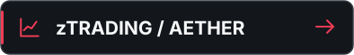

<div align="center">

<picture>
  <source media="(prefers-color-scheme: dark)" srcset="./assets/visual/profile-dark.svg">
  <source media="(prefers-color-scheme: light)" srcset="./assets/visual/profile-light.svg">
  
</picture>

### `JAROD.SYSTEM` <sup>● ONLINE</sup>

<a href="https://jarod.com.br" title="Website"></a>&nbsp;<a href="mailto:contato@jarod.com.br" title="E-mail"></a>&nbsp;<a href="https://instagram.com/jarodofc" title="Instagram"></a>&nbsp;<a href="https://github.com/jarodofc?tab=repositories" title="GitHub"></a>

**Tecnologia aplicada a problemas reais. Interfaces com identidade. Sistemas com propósito.**

`DESIGN`  ·  `WEB ENGINEERING`  ·  `AUTOMATION`  ·  `DIGITAL INTELLIGENCE`

[**Projetos**](#-projetos-em-destaque) &nbsp;·&nbsp; [**Sobre**](#-sobre) &nbsp;·&nbsp; [**Especialidades**](#-especialidades) &nbsp;·&nbsp; [**Contato**](#-estabelecer-conexão)

</div>

---

### `> whoami` <a id="-sobre"></a>

Sou **Jarod M. M. Jr.**, de **Belo Horizonte, MG**. Conecto consultoria automotiva, desenvolvimento web, design de interfaces e automação para transformar processos complexos em experiências digitais mais claras, rápidas e funcionais.

Meu trabalho combina **investigação, engenharia e experiência do usuário**. Cada projeto parte de um problema específico, recebe uma identidade própria e integra um ecossistema visual e técnico consistente.

```text
┌─ JAROD.SYSTEM ──────────────────────────────────┐
│  STATUS      ● ACTIVE                          │
│  LOCATION    Belo Horizonte / BR               │
│  FOCUS       Build · Analyze · Automate        │
│  PRINCIPLE   Clarity in every interaction      │
└─────────────────────────────────────────────────┘
```

### `> ls ./projects` <a id="-projetos-em-destaque"></a>

Os quatro produtos abaixo fazem parte do mesmo portfólio. **Cada cartão contém sua identificação visual e abre o repositório correspondente.**

<div align="center">

<a href="https://github.com/jarodofc/zFORENSE"><picture><source media="(prefers-color-scheme: light)" srcset="./assets/visual/link-forense-light.svg"></picture></a>&nbsp;<a href="https://github.com/jarodofc/ZentraCast"><picture><source media="(prefers-color-scheme: light)" srcset="./assets/visual/link-zentracast-light.svg"></picture></a>

<a href="https://github.com/jarodofc/zTRADING"><picture><source media="(prefers-color-scheme: light)" srcset="./assets/visual/link-trading-light.svg"></picture></a>&nbsp;<a href="https://github.com/jarodofc/zFLY"><picture><source media="(prefers-color-scheme: light)" srcset="./assets/visual/link-fly-light.svg"></picture></a>

</div>

| Projeto | Missão | Explorar |
| :--- | :--- | :--- |
| **◈ zFORENSE · LÚMEN** | Investigação digital, OSINT e análise forense. | [Acessar código](https://github.com/jarodofc/zFORENSE) |
| **▣ ZentraCast** | Experiências web para IPTV, HLS e Web Video Caster. | [Acessar código](https://github.com/jarodofc/ZentraCast) |
| **⌁ zTRADING · AETHER** | Visualização de mercados e indicadores. | [Acessar código](https://github.com/jarodofc/zTRADING) |
| **✈ zFLY · RotaClara** | Pesquisa e comparação de voos. | [Acessar código](https://github.com/jarodofc/zFLY) |

### `> cat capabilities.md` <a id="-especialidades"></a>

**⌘ Engenharia web e UI/UX**  
Interfaces responsivas, sistemas visuais, experiências acessíveis e aplicações orientadas à usabilidade.

**⚙ Automação e integração**  
Fluxos de trabalho, conexões entre serviços, APIs e ferramentas para reduzir tarefas repetitivas.

**◈ Análise e investigação digital**  
Organização de informações, ferramentas de pesquisa, análise de dados e aplicações forenses.

**◇ Consultoria e soluções automotivas**  
Curadoria de seminovos, documentação veicular, simulações de financiamento e soluções de proteção.

### `> connect --secure` <a id="-estabelecer-conexão"></a>

Projetos, parcerias, produtos digitais ou consultoria: **a primeira conexão começa por uma conversa.**

<div align="center">

<a href="https://jarod.com.br" title="Website"></a>&nbsp;<a href="mailto:contato@jarod.com.br" title="E-mail"></a>&nbsp;<a href="https://instagram.com/jarodofc" title="Instagram"></a>&nbsp;<a href="https://github.com/jarodofc?tab=repositories" title="GitHub"></a>

<sub>`JAROD.SYSTEM / DESIGN × CODE × INTELLIGENCE`</sub>

</div>

<details>
<summary><strong>Notas de interface e acessibilidade</strong></summary>

Este perfil usa SVGs vetoriais com versões para os temas claro e escuro, selecionadas por `prefers-color-scheme`. Microanimações podem ser incluídas nos próprios SVGs quando o renderizador do GitHub permitir; a leitura e os links não dependem de animação. O Markdown mantém as informações acessíveis mesmo se imagens externas falharem.

</details>
