<a href="https://github.com/jarodofc?tab=repositories"><strong>PROJETOS</strong></a> &nbsp;·&nbsp;
<a href="https://commons.wikimedia.org/wiki/File:Anonymous_mask.svg"><strong>ANONYMOUS</strong></a> &nbsp;·&nbsp;
<a href="mailto:contato@jarod.com.br?subject=Servi%C3%A7os%20JAROD"><strong>SERVIÇOS</strong></a>

&nbsp;
&nbsp;

